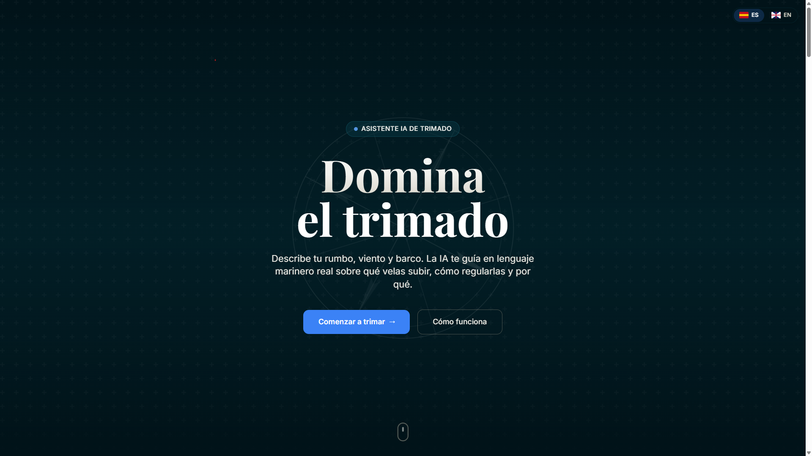
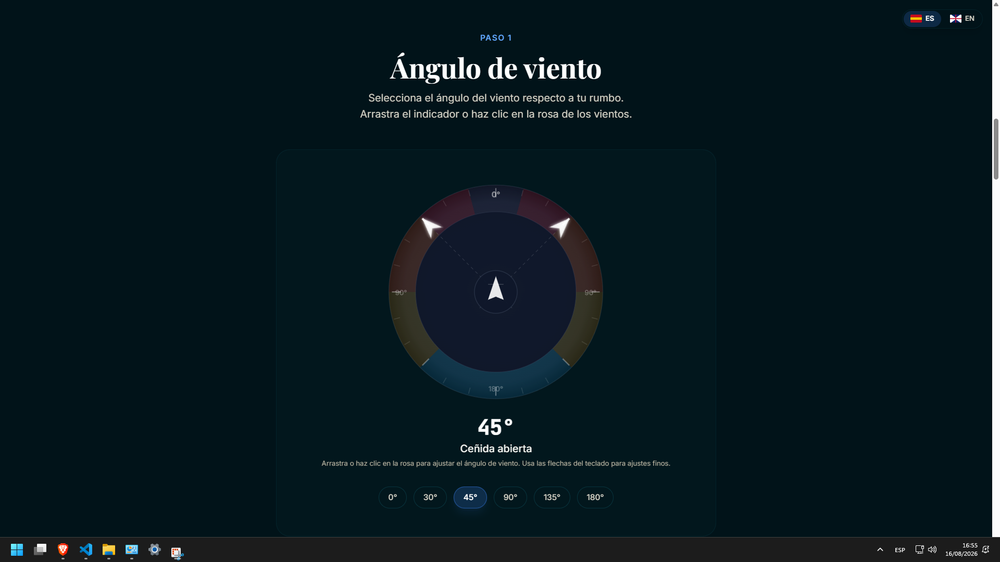
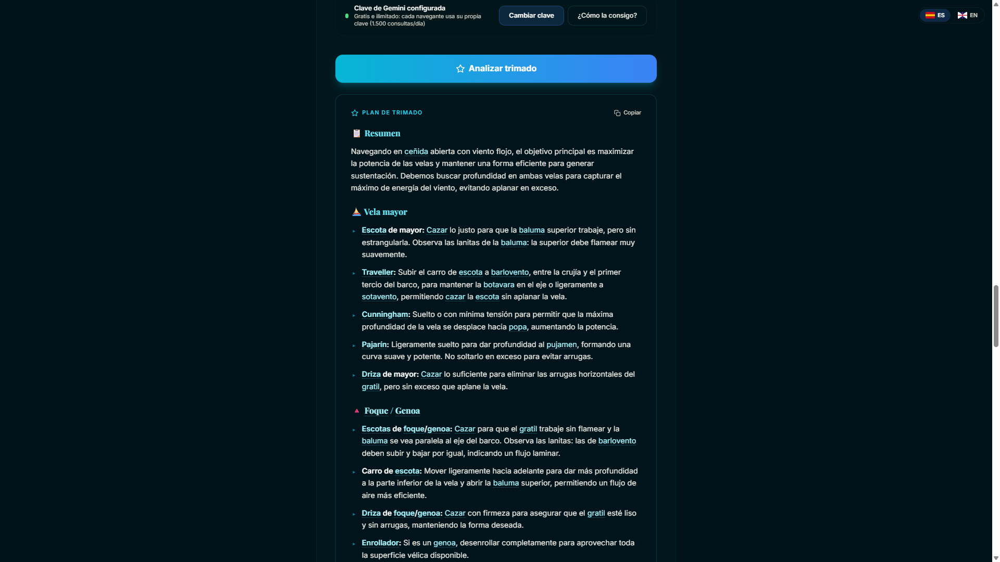
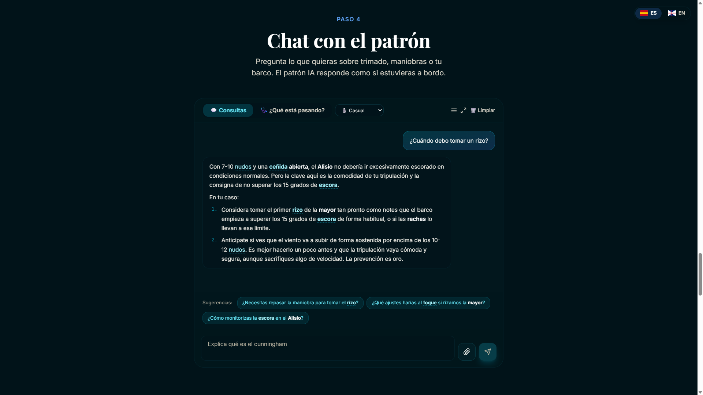
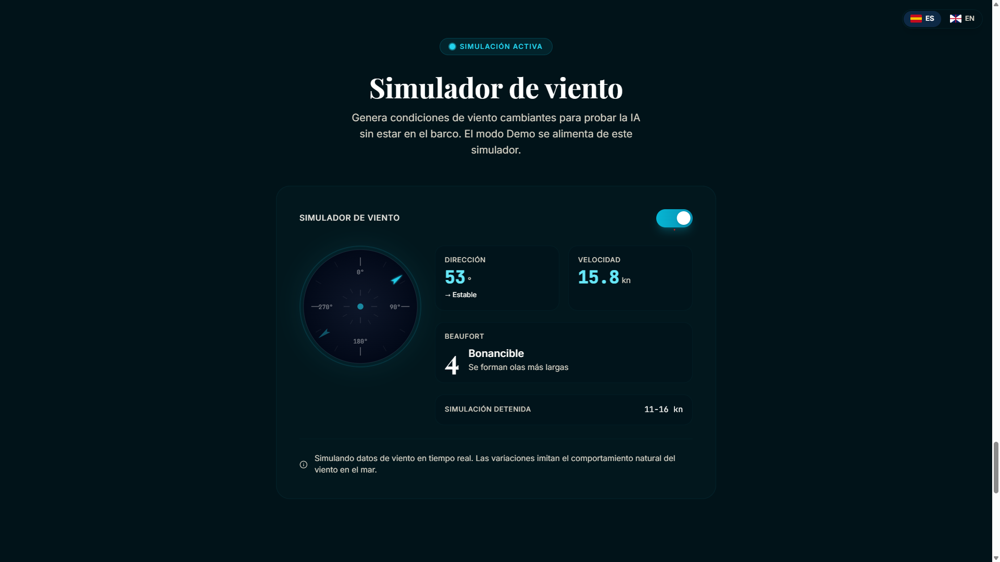
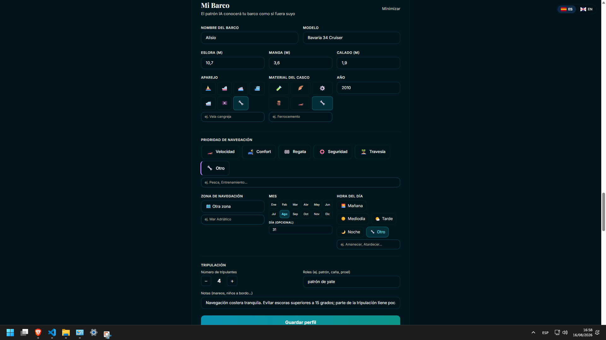

# SailTrim AI

Asistente de trimado de velas con IA, datos de instrumentos NMEA 0183 / Signal K y modo diagnóstico.

[Demo en vivo](https://sail-trim.vercel.app/) · [Licencia MIT](LICENSE)


---

## Qué es

SailTrim traduce una situación de navegación —tipo de barco, fuerza y ángulo del viento, estado del mar y nivel del navegante— en un plan de trimado concreto: qué vela subir, cómo regularla y por qué. También incluye un chat con el patrón, un modo diagnóstico para problemas de trimado y la posibilidad de alimentarse con datos reales del barco.

Está pensado para quien está aprendiendo o quiere contrastar su criterio a bordo, no para sustituir al patrón ni a los manuales del fabricante.

## Capturas

| Portada | Ángulo de viento | Plan de trimado |
|:---:|:---:|:---:|
|  |  |  |

| Chat con el patrón | Simulador de viento | Perfil del barco |
|:---:|:---:|:---:|
|  |  |  |

## Funcionalidades

- Rosa de los vientos interactiva con ratón, táctil y teclado (flechas, Inicio/Fin).
- Recomendaciones de trimado estructuradas: mayor, foque/genoa, cunningham, pajarín, traveller, backstay y rizos.
- Modo diagnóstico: se describe un síntoma y la IA identifica la causa probable y la solución.
- Chat con historial, tonos de respuesta, imágenes adjuntas y pantalla completa.
- Lectura de datos reales mediante WebSocket: NMEA 0183 (`$WIMWV`, `$IIMWV`, `$WIVWT`) y Signal K.
- Simulador de viento para probar la app sin instrumentos.
- Perfil del barco: modelo, aparejo, casco, dimensiones, zona, mes y tripulación.
- Interfaz en español e inglés.
- PWA instalable con funcionamiento offline para las herramientas locales.
- La clave de Gemini y las conversaciones permanecen en el navegador.

## Arquitectura

La aplicación es un frontend estático. No hay servidor propio ni base de datos.

```
Navegador
├── TrimContext            fuente de datos: manual / demo / en vivo
├── useBoatProfile         perfil del barco (localStorage)
├── useChatHistory         conversaciones (localStorage)
├── useNmeaConnection      WebSocket → parser NMEA 0183 y Signal K
├── useWindSimulation      generador de viento sintético
└── lib/gemini + lib/chat  construcción de prompts y llamada a Gemini
        │
        └── generativelanguage.googleapis.com
```

### Flujo de datos

1. El usuario elige condiciones manuales o conecta una fuente (simulador o instrumentos).
2. `getEffectiveConditions` normaliza la situación a un modelo común.
3. Se construye el prompt con las condiciones y el perfil del barco.
4. Se llama a Gemini con una cascada de modelos: si un modelo no está disponible o se alcanza el límite de peticiones, se prueba el siguiente.
5. La respuesta se procesa (markdown, sugerencias, glosario) y se muestra.

### Decisiones técnicas

- **Cero backend (BYOK).** Cada usuario aporta su propia clave de Gemini, así el proyecto no necesita financiar consultas ni mantener un servidor. La contrapartida es que la clave vive en el navegador y es responsabilidad del usuario.
- **Cascada de modelos.** Ante `404` (modelo no disponible) o `429` (límite de peticiones) se reintenta con el siguiente modelo en lugar de fallar al primer intento.
- **Parseo en el cliente.** NMEA y Signal K se interpretan en el navegador; el navegador solo puede recibir datos por WebSocket, no acceder directamente a un puerto serie.
- **localStorage.** Suficiente para ajustes y conversaciones de un portfolio; un producto real usaría IndexedDB.

## Stack

| Capa | Tecnología |
| --- | --- |
| UI | React 19 + TypeScript |
| Build | Vite 8 |
| Estilos | Tailwind CSS 3 |
| IA | Gemini, llamada directa desde el cliente |
| i18n | i18next + react-i18next |
| SEO | react-helmet-async, sitemap, robots.txt, JSON-LD |
| PWA | vite-plugin-pwa |
| Tests | Vitest + Testing Library + jsdom |
| Lint | oxlint |

## Empezar en local

Requisitos: Node.js 20.19+ o 22.12+ (requisito de Vite 8) y npm.

```bash
git clone https://github.com/CesarMed06/SailTrim.git
cd SailTrim
npm install
npm run dev
```

Scripts disponibles:

```bash
npm run dev         # servidor de desarrollo
npm run build       # typecheck + build de producción
npm run preview     # sirve el build
npm test            # ejecuta la suite de tests
npm run typecheck   # solo comprobación de tipos
npm run lint        # oxlint
```

## Clave de Gemini

SailTrim usa la API de Gemini con la clave del propio usuario.

1. Entra en [Google AI Studio](https://aistudio.google.com/apikey) y crea una clave.
2. En la app, abre «Configurar clave» y pégala.

La clave se guarda solo en el navegador y se envía directamente a Google. Puedes borrarla en cualquier momento desde el mismo panel.

## Tests

```bash
npm test
```

La suite cubre el parser NMEA y Signal K (unidades, checksum, estado A/V, radianes), utilidades de chat, manejo de imágenes, hooks de persistencia y estado de conexión, y componentes de UI como la rosa de los vientos, el perfil del barco y el chat.

## Despliegue

Cualquier hosting estático sirve. En Vercel:

1. Importa el repositorio.
2. Build command: `npm run build`. Output: `dist`.
3. No se necesitan variables de entorno.

## Estructura

```
src/
├── components/       UI y tests de componentes
├── context/          estado global de trimado
├── hooks/            perfiles, historial de chat, conexión y simulación
├── lib/              parsers, prompts, imágenes y utilidades
├── i18n/             es.json / en.json
├── data/             glosario náutico
└── types/            tipos compartidos
```

## Limitaciones conocidas

- La IA necesita conexión a internet.
- Por seguridad del navegador, solo se puede conectar a los instrumentos por WebSocket (normalmente con un servidor Signal K); no hay acceso directo al puerto serie.
- En una página HTTPS, `ws://` queda bloqueado: hay que usar `wss://` o ejecutar la app en local.
- La clave de Gemini se guarda en `localStorage` y queda bajo responsabilidad del usuario.
- Es una herramienta educativa: no sustituye el criterio del patrón, los manuales del barco ni las condiciones reales.

## Licencia

MIT. Ver [LICENSE](LICENSE).
